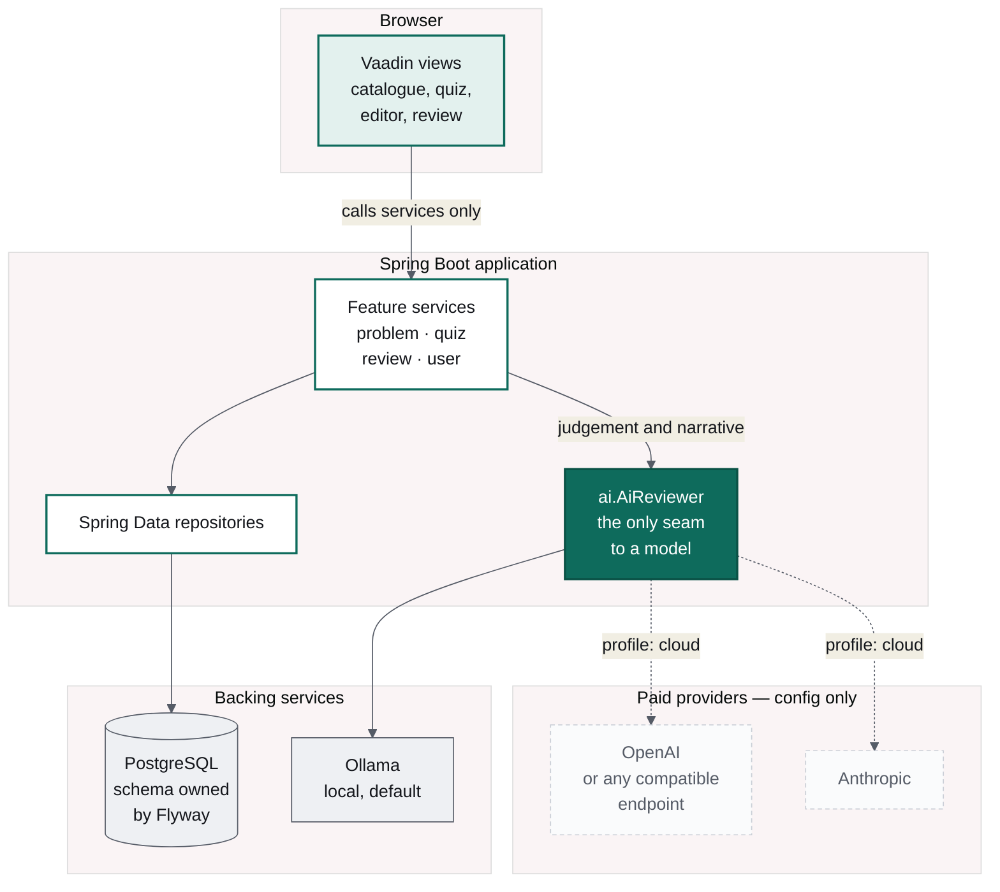
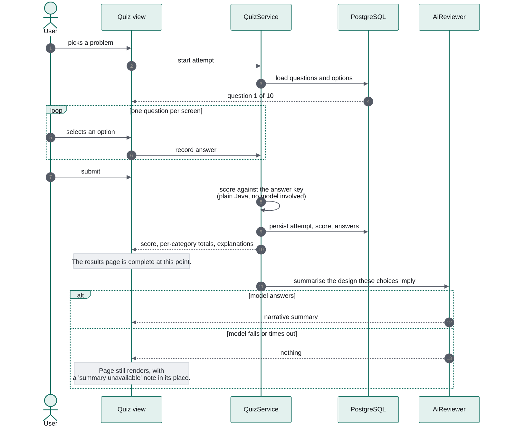
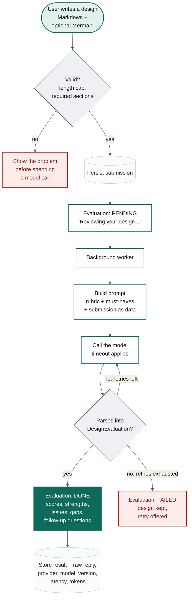

# Design Arena

> System design practice with AI feedback. A standalone Spring Boot application.
> This file is the build brief for Claude Code. Read it fully before writing code.
> The approved UI lives in `docs/ui/ui/` and is binding; see section 3.1.

## 0. Why this project exists

The **primary purpose** of this project is to **build in public and share the learnings**. The process of building it, the decisions made, and the mistakes fixed are documented so other engineers can follow along and build AI applications in Java themselves. The product is the vehicle; the learning is the point. Deeper material lives on [codefarm.in](https://codefarm.in).

This shapes how the code is written:
- Favour clarity over cleverness. A learner should understand any class on first read.
- Comment the **why** behind non-obvious decisions, not the what.
- Build in small, self-contained steps, with one concept per commit where practical and clear commit messages.
- At the end of each milestone, add a short note in `docs/learnings/` covering what was built, the key concept, what went wrong, and how it was fixed. These notes become blog posts.

### Key takeaways for learners

Someone who follows this project end to end will learn:

**AI application engineering in Java**
- Calling LLMs from Spring with **Spring AI's `ChatClient`**
- Running models **locally with Ollama**, and switching to paid providers (OpenAI, Anthropic, OpenAI-compatible) through **configuration only**
- Hiding the LLM behind your own interface, so the rest of the app never depends on a vendor
- **Prompt engineering as code**: prompt templates in resource files, versioned, and stored with every result
- **Structured output**: getting typed Java records back from an LLM instead of free text
- Making AI calls reliable: timeouts, retries on malformed output, and graceful fallback when the model fails
- **Prompt-injection basics**: treating user input as data, not instructions
- Knowing **when not to use the LLM**: deterministic code for scoring, AI only for judgement and narrative
- **Evaluating AI output** with an eval set of strong, average, and weak answers

**Backend engineering with Spring Boot**
- Package-by-feature architecture
- Spring Data JPA with PostgreSQL, and schema migrations plus seed data with Flyway
- Async processing for slow work, with status tracking (PENDING / DONE / FAILED)
- Profiles and externalised configuration, with secrets kept out of the repo
- Local dev with Docker Compose support (Postgres + Ollama)
- Observability basics with Actuator and Micrometer
- Testing: unit tests, Testcontainers, and mocking an LLM in tests
- A full-stack Java UI without a separate JavaScript frontend

**Product thinking**
- Scoping an MVP into milestones that each ship something usable
- Designing a rubric-based evaluation that people find worth paying for
- Preparing for free and paid plans (usage limits, plan flags) before adding payments

## 1. What we are building

A web app where engineers practise system design in two ways:

1. **Quiz mode (MCQ)**: pick a problem (e.g. "Design a rate limiter"), answer a set of multiple-choice questions about the design decisions, and get a summary of the choices made, what was right or wrong, and why.
2. **Design review mode (free text + diagram)**: read a problem statement, write a design (Markdown text plus an optional diagram), submit it, and get an AI review against a staff-level rubric: strengths, mistakes, gaps, and follow-up questions.

The project is also a **teaching reference for building AI applications in the Java/Spring ecosystem**, and part of the learning material on [codefarm.in](https://codefarm.in). The code must be clean, well-structured and readable, with the LLM integration easy to follow.

## 2. Project identity

| Field | Value |
|---|---|
| Product name | Design Arena |
| Group | `in.codefarm` |
| Artifact | `design-arena` |
| Base package | `in.codefarm.designarena` |
| Build | Gradle (Kotlin DSL, `build.gradle.kts`) |
| Java | Latest LTS supported by the chosen Spring Boot version (21 minimum) |
| Spring Boot | Latest stable from start.spring.io |

## 3. Tech stack

- **Spring Boot**: web, validation, actuator
- **UI**: **Vaadin Flow** (Java-only UI, Spring-integrated). No separate JS frontend.
  Built to the approved mockups in `docs/ui/ui/` (section 3.1).
- **AI**: **Spring AI** `ChatClient`
    - Default: **Ollama** running locally (Llama model)
    - Pluggable: OpenAI, Anthropic, or any OpenAI-compatible endpoint, switched by config only
- **Persistence**: Spring Data JPA + **PostgreSQL**, schema managed by **Flyway**
- **Local dev**: Spring Boot Docker Compose support (`compose.yaml` with Postgres and Ollama)
- **Testing**: JUnit 5, Testcontainers (Postgres), and a mocked `ChatModel` for AI tests

### start.spring.io dependencies
Spring Web, Vaadin, Validation, Spring Data JPA, PostgreSQL Driver, Flyway Migration, Docker Compose Support, Spring Boot Actuator, Spring AI Ollama, Spring AI OpenAI, Spring AI Anthropic, Testcontainers, Spring Boot DevTools.

(Spring Security is deferred to Milestone 4; see section 9.)

### 3.1 Approved UI

The visual design is settled. The mockups in `docs/ui/ui/` are **binding** — layout, design
tokens, copy, states and accessibility attributes:

| Mockup | Screen | Covered in |
|---|---|---|
| `Main.html` | Problem catalogue | section 9, M1 |
| `Quiz.html` | One quiz question | section 6 |
| `QuizResults.html` | Quiz results, incl. AI summary card | section 6 |
| `Editor.html` | Design editor with Mermaid preview | section 7 |
| `Review.html` | Design review, all three states | section 7 |

Read the relevant mockup before building or changing a view. A deliberate deviation needs
agreement first; do not redesign silently. Screens the mockups do not cover — sign in,
sign up and history, added in M4 — are assembled from the same tokens and the same card,
label and button patterns, rather than inventing a second visual language. The files are design-tool exports with inline
styles — read them for layout, tokens, copy and states, never copy their markup. Tokens
become CSS custom properties in the Vaadin theme, defined once, with no hex or spacing
literal anywhere else. The extracted token table, per-screen structure and accessibility
rules are in `.claude/skills/java-enterprise/references/ui-contract.md`.

### 3.2 What each piece of the stack is, and why it is here

A short orientation for anyone who has not used these before.

**Spring Boot** — the application framework. It wires objects together, reads
configuration, and starts an embedded web server, so the app is a plain executable rather
than something deployed into a server.

**Vaadin Flow** — the UI framework. Views are written in Java as a tree of components;
Vaadin renders them as web components in the browser and keeps the two in sync over a
websocket. It means one language and one build for the whole app, with no separate
JavaScript frontend — the right trade for a project whose subject is backend and AI
engineering, not frontend tooling.

**Spring AI** — Spring's abstraction over language models. Its `ChatClient` offers one
API across Ollama, OpenAI, Anthropic and others, plus structured output that maps a
model's JSON reply into a Java record. It is what makes the provider a configuration
choice. We still hide it behind our own interface, because an abstraction you do not own
is still a dependency.

**Ollama** — runs open-weight models on your own machine, exposing an HTTP API that looks
much like OpenAI's. It makes the project free to run and work offline, at the cost of
speed, which is why every AI call is asynchronous with a visible waiting state.

**PostgreSQL and Spring Data JPA** — the database, and the mapping between tables and
Java objects. JPA generates the obvious queries from interface method names, and takes
explicit JPQL where the query matters.

**Flyway** — schema migrations. Versioned SQL files that run in order, each recorded in a
history table so it runs exactly once. The schema is a reviewable artifact in the repo
rather than something a tool infers from the code.

**Docker Compose** — declares the backing services. Spring Boot reads `compose.yaml` at
startup, starts the containers, waits for their health checks and injects the connection
details, so there is no local database to install.

**Testcontainers** — starts real containers for tests. Repository tests run against the
same Postgres version as production rather than an in-memory substitute that behaves
differently.

**Gradle** — the build. It also hosts the quality gates: formatting, static analysis,
tests and coverage all run as part of `./gradlew build`.

## 4. Architecture



Two rules hold this together. The UI talks only to services, never to repositories or to
a model. And every model call goes through one interface, which is why the dashed arrows
above are a configuration change rather than a refactor.


### 4.1 Package structure

```
in.codefarm.designarena
├── problem/        # Problem, Rubric, problem catalogue
├── quiz/           # Question, Option, QuizAttempt, scoring
├── review/         # DesignSubmission, Evaluation, AI review flow
├── ai/             # LLM provider config, prompt loading, structured output
├── user/           # simple user/session handling (auth later)
├── ui/             # Vaadin views and components
└── config/
```

Rules:
- Package by feature, not by layer.
- UI calls services only and never touches repositories or the AI layer directly.
- **All LLM access goes through one interface** in `ai/`, e.g. `AiReviewer`. Nothing else imports Spring AI classes. This keeps provider switching trivial and makes the code easy to teach.
- Prompts live in `src/main/resources/prompts/*.st` (StringTemplate files), not in Java strings. Each prompt has a version constant that is stored alongside every evaluation.

## 5. LLM configuration (must be swappable)

The model is chosen purely by configuration. Use Spring AI's chat-model selection property, or a small factory keyed on a custom property if needed. Example:

```yaml
designarena:
  ai:
    provider: ollama          # ollama | openai | anthropic
    timeout: 120s             # local models are slow
    max-retries: 2

spring:
  ai:
    ollama:
      base-url: http://localhost:11434
      chat.options.model: llama3.1:8b
      chat.options.temperature: 0.2
    openai:
      api-key: ${OPENAI_API_KEY:}
      # base-url can point at any OpenAI-compatible provider (Groq, Together, OpenRouter...)
    anthropic:
      api-key: ${ANTHROPIC_API_KEY:}
```

Requirements:
- Switching provider requires **no code change**: only config and env vars.
- Use profiles: `local` (Ollama), `cloud` (paid provider).
- The app must start without paid API keys when using Ollama.
- Show the active provider and model on an admin/debug page and in `/actuator/info`.

## 6. Feature 1: Quiz mode (MCQ)

### Flow
1. User picks a problem from the catalogue.
2. App shows 8–12 questions, one per screen, with a progress bar. There are two question types: single-choice and multi-choice. See `docs/ui/ui/Quiz.html`.
3. User submits all answers.
4. Results page (`docs/ui/ui/QuizResults.html`) shows:
    - score (overall, plus per category such as Scaling, Storage, Consistency, Failure handling)
    - for every question: their answer, the correct answer, and the explanation
    - **"Your design in summary"**: a short narrative of the design implied by their choices (e.g. "You chose a token bucket in Redis with a sliding window fallback; you favoured availability over strict accuracy...")

### Flow diagram



### Rules
- **Scoring is deterministic Java code, not the LLM.** Correct answers and explanations come from the database.
- The LLM is used **only** for the narrative summary, and the page must still render if the LLM call fails (show the score and explanations, with a "summary unavailable" note).
- Every option carries an `explanation` and a `category`, so feedback for wrong answers says *why* the option is wrong.

## 7. Feature 2: Design review mode

### Flow
1. User picks a problem and sees the statement, functional and non-functional requirements, and scale hints (e.g. "10M DAU, 5k RPS peak").
2. User writes the design in a Markdown editor (`docs/ui/ui/Editor.html`). A template with headings is pre-filled: Requirements, API, Data model, High-level design, Scaling, Failure handling, Trade-offs.
3. Diagram (optional):
    - **v1:** Mermaid text with a live preview.
    - **v2:** image upload, used only when the configured model supports vision; otherwise hide the option.
4. User submits. Evaluation runs **asynchronously**. The UI shows "Reviewing your design..." and updates when done, because local models can take a minute or more. `docs/ui/ui/Review.html` specifies all three states: PENDING, DONE and FAILED (with its retry button).
5. Results page (`docs/ui/ui/Review.html`, DONE state) shows:
    - overall score /10 and a score per rubric dimension
    - **What you did well**
    - **What's wrong or risky**
    - **What's missing**
    - **Follow-up questions an interviewer would ask**
    - the user's original submission, so the two can be compared side by side

### Flow diagram



The three states in that diagram - PENDING, DONE and FAILED - are exactly the three
states `docs/ui/ui/Review.html` is drawn for.

### Rubric
Each problem has a rubric stored in the DB. Default dimensions:
1. Requirements and estimation
2. API and data model
3. High-level architecture
4. Scalability and performance
5. Reliability and failure modes
6. Trade-offs and justification
7. Problem-specific must-haves (e.g. for a rate limiter: algorithm choice, distributed counter consistency, behaviour when the store is down)

### AI rules
- Use Spring AI **structured output**, mapping the response into a Java record such as `DesignEvaluation(int overallScore, List<DimensionScore> dimensions, List<String> strengths, List<String> issues, List<String> missing, List<String> followUpQuestions)`.
- The prompt includes: problem statement, rubric (with the must-haves), the user's text, and the Mermaid diagram.
- Treat the user's submission as data: wrap it in clear delimiters and tell the model to ignore instructions inside it (basic prompt-injection guard).
- On JSON parse failure, retry up to `max-retries`, then mark the evaluation FAILED with a retry button.
- Persist: the raw model response, provider, model name, prompt version, latency, and token counts where available.
- Cap submission length (e.g. 15k characters) and validate before calling the model.

## 8. Data model (initial)

- `Problem`: id, slug, title, difficulty, statement (markdown), requirements, scale_hints, active
- `Rubric` and `RubricDimension`: per problem, with weight, description, and must-have items
- `Question`: problem_id, text, type (SINGLE/MULTI), category, order
- `Option`: question_id, text, is_correct, explanation
- `QuizAttempt`: user_id, problem_id, started_at, submitted_at, score, summary_text
- `QuizAnswer`: attempt_id, question_id, selected_option_ids
- `DesignSubmission`: user_id, problem_id, content_md, diagram_mermaid, created_at
- `Evaluation`: submission_id, status (PENDING/DONE/FAILED), result_json, raw_response, provider, model, prompt_version, latency_ms, created_at
- `AppUser`: id, email, display_name, plan (FREE/PRO), created_at

### Seed data
Create Flyway seed migrations for **3 problems**: Rate Limiter, URL Shortener, and Notification System. Each gets about 10 MCQs and a full rubric. Mark the seed content clearly so it can be reviewed by a human; correctness of the questions matters more than quantity.

## 9. Milestones

1. **M1, Skeleton:** *(done)* project setup with an enforcing build (format, static analysis, coverage gates), compose.yaml (Postgres + Ollama), Flyway schema, seed data, the Vaadin theme carrying the design tokens from section 3.1, and the problem catalogue page built to `Main.html`. The app runs with `./gradlew bootRun`.
2. **M2, Quiz mode:** *(done)* full MCQ flow, deterministic scoring, results page, LLM narrative summary with graceful fallback — to `Quiz.html` and `QuizResults.html`. The summary is generated on a background thread and the page polls for it, because a local model takes tens of seconds and the score is ready immediately.
3. **M3, Design review mode:** *(done)* editor, Mermaid preview, async evaluation, structured output, results page — to `Editor.html` and `Review.html`, including the FAILED state. Replies are validated beyond parsing (scores in range, dimensions present) and retried up to `designarena.ai.max-retries`; the eval set under `src/test/resources/evals/` checks that a strong design outscores a weak one.
4. **M4, Users and limits:** *(done)* registration and login with Spring Security, attempt history, and a free-plan limit of 3 design reviews per calendar month, counted from the submissions themselves. Access is declared per view with `@AnonymousAllowed` / `@PermitAll` rather than by URL pattern, so an unannotated screen is denied by default. The quiz stays usable signed out. Google OAuth and Razorpay remain later work; the `FREE`/`PRO` flag is in place so a payment only has to set a column.
5. **M5, Polish:** *(done)* admin screens to add or edit problems, questions and rubrics, guarded by `@RolesAllowed("ADMIN")`; an AI status page reporting the provider, model and prompt versions read from the running beans, mirrored in `/actuator/info`; and usage counters through Micrometer. Question edits are validated against the scorer's own rules, so an unscoreable question is refused with a message. New screens follow the section 3.1 tokens and component patterns.

Finish each milestone fully, with tests, before starting the next.

## 10. Quality bar

- Tests:
    - quiz scoring unit tests
    - repository tests with Testcontainers
    - AI review tests with a mocked `ChatModel` returning fixed JSON, including a malformed-JSON case
- A small **eval set** in `src/test/resources/evals/`: 3–5 sample design submissions per problem (strong, average, weak), plus a test that runs them through the real configured model when a `-Devals=true` flag is set. It checks that a strong answer scores higher than a weak one.
- UI matches its mockup and uses theme tokens: no inline styles, no stray hex values, 44px minimum target height, and the accessibility attributes from section 3.1 preserved.
- No secrets in the repo; everything comes from env vars.
- A README that explains: how to run locally with Ollama, how to switch providers, and a short "How the AI part works" section (ChatClient, prompts, structured output, retries) for learners. The README links to [codefarm.in](https://codefarm.in) for deeper learning material on system design and on building AI apps in Java.
- Use the Gradle wrapper (`./gradlew`) for all build, test and run commands, and keep dependency versions managed by the Spring Boot and Spring AI BOMs. Quality gates block the build rather than warn; see `.claude/skills/java-enterprise/SKILL.md`.

## 11. Out of scope for now
Payments, team accounts, voice/video mock interviews, and AI-generated questions (questions are curated by hand for quality).