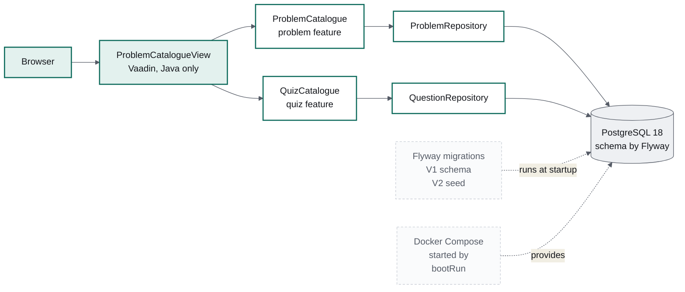
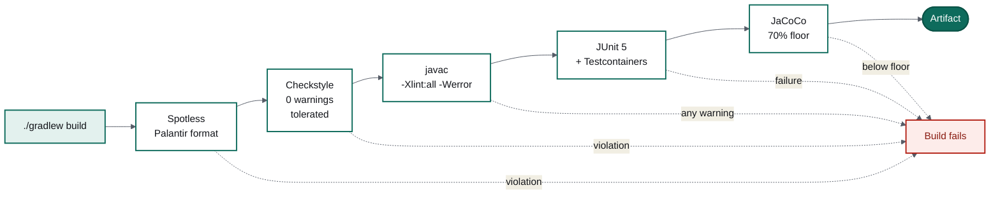

# Build the gate before you build the app

### Milestone 1 of Design Arena: a Spring Boot skeleton where the build refuses work that is not finished

*Part 1 of a series on building an AI application in Java. The product is
[Design Arena](https://codefarm.in): practise system design, get it reviewed by a model
against a staff-level rubric. Everything here is real code from the repository.*

---

Most projects add static analysis in month six, discover four hundred violations, and
set the threshold to four hundred. The number never goes down. So this project started
at the other end: before a single feature existed, the build was made strict enough that
it would reject my own work. Milestone 1 is that build, plus just enough application to
prove it works — a problem catalogue, backed by a real schema and real seed data.

Here is what exists after milestone 1.



Two services feed one screen, because the problem and the number of questions about it
belong to two different features. The view composes them. Neither feature imports the
other.

## The stack, briefly

**Spring Boot** starts the app and wires it together. **Vaadin Flow** is the UI: views
are Java objects, rendered as web components in the browser and kept in sync over a
websocket — one language, one build, no separate frontend. **Flyway** owns the database
schema as versioned SQL files that run in order, exactly once each. **Docker Compose**
declares Postgres and Ollama; Spring Boot reads `compose.yaml` at startup, starts the
containers, waits for their health checks and injects the connection details.
**Testcontainers** does the same for tests, against the same Postgres version.
**Ollama** runs open-weight models locally, and **Spring AI** will sit in front of it
from milestone 2 — both are configured here but not yet called.

The result is that a new machine needs Docker and nothing else:

```bash
./gradlew bootRun
```

That starts the containers, waits for health, migrates the schema, seeds three problems
with thirty reviewed questions, and serves the app. The JDK is downloaded by the build
itself if the machine does not have the pinned version.

## The gate

Every one of these **fails** the build. None of them warns.



The strictest of these is `-Werror`: every compiler warning is an error. It sounds
intolerable and mostly is not, because it forces you to deal with deprecations on the
day they appear rather than the day the API is removed. It caught one within the hour —
see below.

The rule that goes with a strict gate: **when a gate fires on reasonable code, fix the
gate, not the threshold.** That happened too, and it was the most instructive failure of
the milestone.

## Three decisions worth stealing

**Let the schema own the mapping.** Flyway creates the schema; Hibernate runs with
`ddl-auto: validate`, which compares the entity mapping to the real tables at startup
and refuses to start if they disagree. A whole category of production bug becomes a
failure on your own machine, seconds after you cause it.

**Entities do not leave their package.** `Problem` is package-private. The catalogue
query projects columns straight into a record:

```java
@Query("""
        SELECT new in.codefarm.designarena.problem.ProblemSummary(p.id, p.slug, p.title, p.difficulty, p.blurb)
        FROM Problem p
        WHERE p.active = TRUE
        ORDER BY p.position
        """)
List<ProblemSummary> findActiveSummaries();
```

Nothing outside the feature can touch the database shape or trigger a lazy load. The
constraint paid for itself immediately: the quiz feature cannot hold a `@ManyToOne` to
`Problem`, so it correlates by id instead — and the two features stay genuinely
independent rather than nominally so.

**Repositories expose only what is used.** Extending Spring Data's bare `Repository`
marker rather than `JpaRepository` means there is no inherited `findAll()` to reach for,
and no `save` or `delete` until a feature actually needs one.

## Tokens, not hex values

The catalogue was built to an approved mockup, which raises a question every project
answers badly at least once: where do the colours live? Here, in exactly one file.
Every colour, type size, radius and spacing step from the design is a CSS custom
property in `design-arena.css`, and no Java class contains a hex value:

```css
html {
  --da-brand: #0e6b5c;
  --da-surface: #ffffff;
  --da-radius-card: 12px;
  --da-target: 44px; /* minimum interactive target. An accessibility floor. */
}
```

Views only ever add class names. The practical test is whether a design change is a
one-file change, and it is. The same discipline caught a lapse of my own: one nav
button had been styled with two inline `getStyle()` calls in Java. They are now a class,
and a check confirms the rendered page carries no inline styles at all.

Fonts are self-hosted rather than pulled from Google Fonts — one fewer third-party
request on every page load, and the page renders the same offline. IBM Plex Sans ships
as a variable font, so a single 40KB file covers all four weights the design uses.

## Four things that broke

**1. Postgres 18 moved its data directory.** The container exited immediately,
complaining about an unused mount. Postgres 18 wants the volume at
`/var/lib/postgresql`, one level above the old `/var/lib/postgresql/data`, so that a
future major-version upgrade can use `pg_upgrade --link` across a single mount point.
Moving the mount up one level fixed it.

**2. The OpenAI starter demanded a key the app never uses.** Startup failed with:

```
At least one credential source must be specified: credential (apiKey), ...
  at OpenAiAudioSpeechAutoConfiguration
```

Audio speech — in an app that will only ever send chat messages. The setting
`spring.ai.model.chat=ollama` selects the *chat* model only; the provider starters also
auto-configure embedding, image, audio and moderation clients, and those tried to build
themselves without credentials. The fix belongs in configuration, not code:

```yaml
spring:
  ai:
    model:
      embedding: none
      image: none
      moderation: none
      audio:
        speech: none
        transcription: none
```

The general lesson: a starter configures everything the vendor offers, not everything
you asked for. Turn off what you do not use, or it will ask you for credentials at the
worst moment.

**3. A lint rule that punished the thing it was meant to encourage.** A custom Checkstyle
rule banned field injection by matching `@Autowired` followed by a declaration. It also
matched an `@Autowired` *constructor* — exactly the pattern it exists to promote. The
rule now requires no parentheses before the semicolon, so only fields match:

```xml
<property name="format"
          value="@Autowired\s+(?:(?:private|protected|public|final|static)\s+)*[\w.&lt;&gt;\[\]]+\s+\w+\s*;"/>
```

Then the tests were converted to real constructor injection, with
`spring.test.constructor.autowire.mode = all` in `junit-platform.properties` so no
annotation is needed at all. Tightening the rule took ten minutes. Adding a suppression
would have taken two, and would have left a rule nobody trusts.

**4. Vaadin 25 deprecated `@Theme`, and `-Werror` would not let it pass.** Theming moved
from the `themes/<name>` folder convention to ordinary stylesheet imports. The design
tokens now live in `src/main/frontend/styles/design-arena.css` and are loaded with
`@CssImport` on the layout every screen renders inside. Without `-Werror` this would
have been a line in a build log that nobody read until Vaadin 26 removed the annotation.

Two smaller ones, for completeness. `-Xlint:all` fires `serial` on every Vaadin
component, because they are all `Serializable`; that single category is disabled, with
the reason recorded in the build file. And Spotless was pointed at
`src/main/frontend/**/*.css`, which includes Vaadin's generated output — Gradle correctly
refused, citing an undeclared task dependency, and the target was narrowed to our own
stylesheet directory.

## What four tests are worth

The suite is small and deliberately not about line coverage.

The first test starts the whole application against a real Postgres from Testcontainers.
It looks like it asserts nothing — there is no `assertThat` in it — but with
`ddl-auto: validate` in play, *starting* is the assertion: Flyway applies both
migrations and Hibernate compares every mapped field to the real columns. Forget a
migration, rename a column, add a field without one, and this test fails.

The other three run the catalogue queries against those same real migrations, so they
cover the seed data and the SQL together. If V2 ever stops producing three active
problems in catalogue order, or the grouped question count drifts, the build goes red.

That is the shape I want early: a handful of tests that fail for real reasons, against
real infrastructure, rather than many that assert a mock returned what the mock was told
to return. Coverage on non-UI code happens to be 100% — but the floor in the build is
70%, because the number is a floor, not a target to perform for.

## On seed data

Three problems, three rubrics, thirty questions, a hundred and twenty options — each
option carrying an explanation of *why* it is right or wrong, because that explanation is
the product. It took longer than the code. A SQL assertion checks what a human reviewer
would otherwise have to: every single-choice question has exactly one correct option,
every multi-choice at least two.

## What the screen does not do yet

The catalogue renders "Take quiz" and "Write a design" exactly where the design puts
them — disabled, with the reason in a tooltip. The layout is final and nobody clicks a
button that silently does nothing. They come alive in milestones 2 and 3.

**Next**: the quiz flow. Deterministic scoring in plain Java, a results page, and the
first real call to a language model — with a page that still renders when the model does
not answer.
