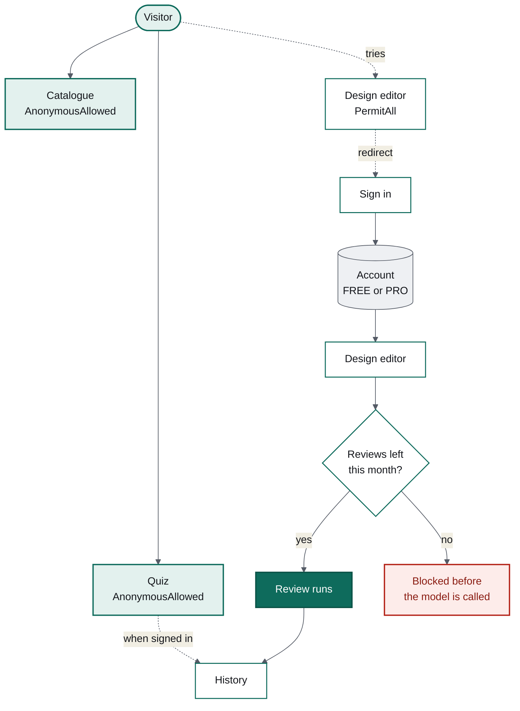
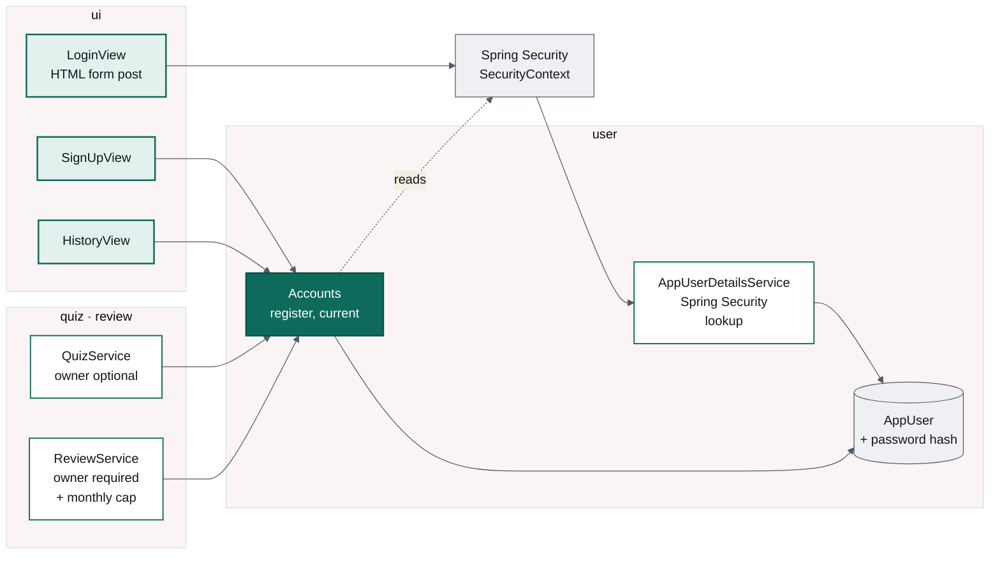

# The cheapest way to lock a door is to forget to open it

### Milestone 4 of Design Arena: Spring Security where the rules live next to the screens, and a monthly cap that exists because the model costs money

*Part 4 of a series on building an AI application in Java. The first three built an
enforcing build, a quiz with deterministic scoring, and an AI design review with
structured output. This one adds the thing every side project puts off: accounts.*

---

Up to now Design Arena has had no idea who you are. That was fine while everything was
free. It stops being fine the moment one of the features costs a minute of a model's
time, because "unlimited free design reviews for anonymous visitors" is not a product,
it is a way to lose money quietly.

So milestone 4 adds three things that only make sense together: accounts, a history of
what you have done, and a cap on the expensive feature.



Note what stays open. The quiz asks ten multiple-choice questions and costs nothing to
serve, so it works signed out: an anonymous attempt is owned by nobody and simply never
appears in a history. Requiring a sign-up before somebody can try the product is a tax
you pay in users, and here it buys nothing.

## The rule lives next to the screen

Spring Security's familiar shape is a list of URL patterns in a configuration class.
Vaadin offers a better one: the rule goes on the view.

```java
@Route(value = "quiz/:slug", layout = MainLayout.class)
@AnonymousAllowed
public final class QuizView extends Div { ... }

@Route(value = "design/:slug", layout = MainLayout.class)
@PermitAll
public final class DesignEditorView extends Div { ... }
```

The reason to prefer this is not elegance, it is where your eyes are. A pattern list is a
second file that somebody has to remember to edit six months from now, and the failure
mode when they forget is a screen that is accidentally public. With annotations the
decision sits in the file you are already in, and **an unannotated view is denied**.
Forgetting to decide produces a locked door, not an open one.

That default has teeth, which I discovered immediately.

## The first thing that broke, and the log that explained it

With the annotations in place, every page redirected to the login screen — including the
catalogue, which is explicitly `@AnonymousAllowed`. Two separate causes, and Vaadin
diagnosed the second one for me in plain English:

```
Denied access to view 'ProblemCatalogueView' due to parent layout 'MainLayout'
access rules. The view allows broader access than the layout, which is likely a
configuration error.
```

`MainLayout` is the frame every screen renders inside, and it had no annotation — so it
defaulted to denied, and a view cannot be more permissive than the layout wrapping it.
Annotating the layout `@AnonymousAllowed` fixed it: the layout is a frame, not a screen,
and each view inside still declares its own rule.

The other cause was mine. Spring Security's HTTP layer was still demanding
authentication for every request, so an anonymous visitor was redirected before any view
annotation was consulted. Once authorisation is decided per view, the HTTP layer should
get out of the way:

```java
http.with(vaadin(), configurer -> configurer
        .loginView(LoginView.class, "/")
        .anyRequest(AuthorizedUrl::permitAll))
```

That line looks alarming out of context — *permit everything?* — and it is correct
precisely because something else is doing the deciding. Two access-control mechanisms
disagreeing is worse than either alone.

## Where identity enters the code



`Accounts` is the only door into identity, and it reads the current user from Spring
Security's `SecurityContextHolder` rather than from anything Vaadin-specific. That keeps
services testable without a browser: the review tests put a token in the context and call
the service directly.

It also contains the bug I would otherwise have shipped. The obvious way to ask "is
anybody signed in" is wrong twice over:

```java
// Wrong. An anonymous visitor HAS an Authentication, and it reports isAuthenticated()
// as true. The == is comparing object references against a string literal as well.
if (authentication.getPrincipal() == "anonymousUser") { ... }

// Right: the token type is what distinguishes an anonymous visitor.
if (authentication instanceof AnonymousAuthenticationToken) { ... }
```

A test now registers an anonymous token explicitly and asserts that `current()` is empty,
because the version that reads naturally is the version that is wrong.

## Sign-in is a form post, deliberately

The login screen is a plain HTML `<form method="post" action="login">`, not a Vaadin
component sending credentials over the websocket. Spring Security's filter has to see a
real request to authenticate it, and the side benefit is that password managers and
autofill work, because it is an ordinary login form.

There is no mockup for this screen, or for sign-up or history. The approved designs cover
the five screens of the product itself. Rather than invent a second visual language, they
are assembled from the same tokens and the same card, label and button patterns — which
is the return on having had a token system since milestone 1.

Two details worth copying. Passwords are hashed with BCrypt, and a test asserts the
stored value neither contains the password nor fails to verify it. And the "no such user"
message says only *Bad credentials*:

```java
.orElseThrow(() -> new UsernameNotFoundException("Bad credentials"));
```

A message that distinguishes "no account with that email" from "wrong password" is a free
account-enumeration oracle. The test for this asserts on what the message must **not**
contain.

## The cap: counted, not tracked

A free account gets three design reviews a calendar month. The number is configuration,
because it is a commercial decision somebody will change without reading this code:

```yaml
designarena:
  limits:
    free-reviews-per-month: 3
```

The implementation counts rows:

```java
long used = store.countSubmissionsBetween(account.id(), startOfMonth, startOfNextMonth);
```

The tempting alternative is a counter on the account, incremented per review. Resist it.
A counter has to be made correct across every failure path — the review that crashed, the
retry, the one that was refunded because the model never answered — and when it drifts,
it drifts silently in your customer's favour or yours. A count over the submissions
themselves cannot drift, because the submissions *are* the record.

A calendar month, not a rolling thirty days, for the same reason the message carries
numbers: it can be explained in four words. "Resets on 1 November" needs no arithmetic
from the person reading it.

Two placement decisions matter more than the counting:

**The check happens before the model is called.** A test asserts exactly that, by
counting calls to the stubbed model after a refused submission. A cap that stops the
page but not the spend is not a cap.

**The number is shown before you write, not after you submit.** The editor footer says
"2 design reviews left this month" while the page is still blank. Finding out that a
review was never going to run, after writing one, is the kind of thing people do not
come back from.

## What testing security actually looks like

The temptation with Spring Security is to test it with `@WithMockUser` and move on. That
annotation invents a principal out of thin air — convenient, and useless here, because
the whole question is whether a submission ends up owned by a row in `app_user`. The
review tests register a real account and put a real token in the context:

```java
account = accounts.register("reviewer@example.com", "Test Reviewer", "a-long-enough-password");
SecurityContextHolder.getContext()
        .setAuthentication(new UsernamePasswordAuthenticationToken(account.email(), "n/a", List.of()));
```

Nine tests then cover the parts that would actually hurt: that the submission records
*who* wrote it, that an unauthenticated call is refused outright, that the fourth review
in a month is blocked without calling the model, that one account's usage does not touch
another's, that a `PRO` account is not capped, and that a submission backdated into last
month stops counting. The clock is fixed, so "last month" is a SQL interval rather than a
test that behaves differently on the first of the month.

That last one is worth dwelling on. A limit that resets on a calendar boundary is a
natural home for a bug that appears for one day a month and cannot be reproduced on any
other. Injecting the clock makes it an ordinary assertion.

## What my own test data broke

The history page crashed with a `NullPointerException` the first time I opened it.

The cause was rows I had inserted by hand to test the cap: submissions with no evaluation
attached. The history query reads the latest evaluation per submission, got null, and the
view called `.name()` on it.

It would have been easy to call that a bad test fixture and move on, because the
application never creates a submission without an evaluation — they are written in one
transaction. I did not, for two reasons. A page that falls over on an unexpected null is
a page that falls over the first time an operator fixes something by hand. And "the code
cannot produce that state" is a claim with a short shelf life. So the record documents
the nullability, exposes it as an `Optional`, and the row renders as `NO REVIEW`. The
regression test deletes the evaluation and asserts the page still has something to show.

## Ready for payments, without payments

`UserPlan` has two values and the cap only applies to `FREE`. Nothing charges anybody,
and no payment provider is integrated. But every limit in the application is already
expressed in terms of a plan rather than hardcoded, so the day a payment succeeds, the
work is to set one column. That is the whole point of putting the flag in before the
money: the policy question gets answered while it is still cheap to change the answer.

**Next**: milestone 5, polish — an admin screen for problems and rubrics, a page showing
which provider and model are actually live, and usage metrics through Actuator.
