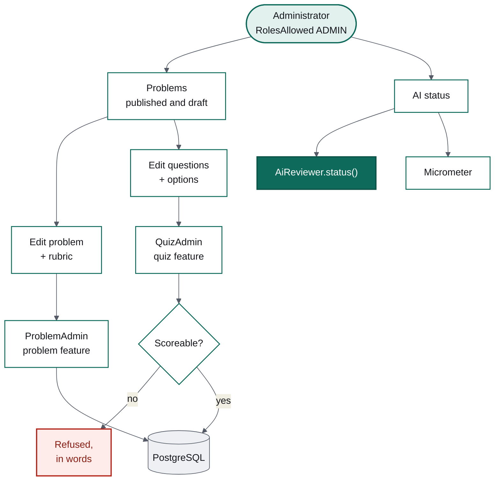
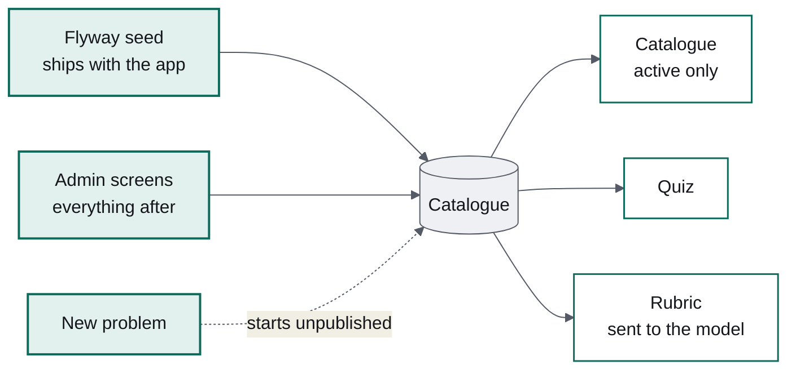

# Three constraints, two of which I had written myself

### Milestone 5 of Design Arena: an admin area, a page that says which model is really answering, and the build pushing back

*Part 5 of a series on building an AI application in Java. The first four built an
enforcing build, a quiz, an AI design review and accounts. This one is the unglamorous
milestone: the screens that let somebody run the thing without a database client.*

---

Every project reaches the point where content changes require SQL. Design Arena's three
problems, their rubrics and their thirty questions all arrived through Flyway migrations,
which is right for content that ships with the application and wrong for everything after
that.

Milestone 5 adds the admin area, a page answering "which model is actually running?", and
usage counters. What made it interesting was not the CRUD. It was being told *no* three
times — once by Postgres, and twice by rules I had written myself in milestone 1.



## The admin screens belong to the features

There is no `admin` package. `ProblemAdmin` lives in `problem`, `QuizAdmin` lives in
`quiz`, and the views live in `ui`. An admin package would have needed access to both
features' entities, and the only way to give it that is to make those entities public —
undoing the boundary that has held since milestone 1 for the sake of a folder name.

Each feature grew a second repository instead:

```java
/**
 * Separate from {@link ProblemRepository} because it needs what the catalogue must not
 * have: whole entities, inactive rows, and the ability to write.
 */
interface ProblemAdminRepository extends Repository<Problem, Long> { ... }
```

A reader can now see at a glance that the catalogue cannot modify anything, because the
repository it uses has no `save`.

## Validation is where the scorer's rules get written down twice

`QuizAdmin` refuses a question that could not be scored fairly:

```java
if (draft.type() == QuestionType.SINGLE && correct > 1) {
    throw new InvalidQuestionException("A single-choice question can only have one correct option");
}
```

That rule is not arbitrary. `QuizScorer` awards the point when the selection *equals* the
set of correct options, so a single-choice question with two correct answers can never be
answered correctly by anybody. Without this check the bug would surface as a person losing
a point they earned, weeks after the edit, with nothing in the logs.

Ten tests cover the refusals, and one covers the thing that matters more: that a refused
edit leaves the existing question untouched. A validation that half-saves is worse than
none.

## Editing a list without building a list editor

Requirements, scale hints and rubric must-haves are ordered lists of plain strings. The
obvious admin UI is a repeating row with add, remove and reorder buttons — three controls,
drag handles, and a surprising amount of state.

They are edited as a textarea, one line per item:

```java
/** Splits a textarea into an ordered list, ignoring blank lines. */
private static List<String> lines(String value) {
    return Arrays.stream(value.split("\n")).map(String::strip).filter(line -> !line.isBlank()).toList();
}
```

The whole list is visible at once, reordering is moving a line, and deleting is deleting a
line. It costs no UI machinery and no new interaction for somebody to learn. The moment
these items grow structure beyond text — a weight, a flag, an id — they earn a real
editor; today they have none, and building one would be inventing work.

Questions get the opposite treatment, because they genuinely are structured: each is a
card with its options beneath it, and each saves on its own. Saving one question at a time
rather than the whole set means a validation failure on question seven cannot discard the
edits made to question two.



A new problem starts **unpublished**, so a half-written problem is never visible to
somebody practising; publishing is a separate, deliberate tick. Unpublishing takes a
problem out of the catalogue without deleting it, so existing history and old links keep
working.

One more decision hides in the rubric editor. Editing a rubric does not touch reviews
already produced: each evaluation stored its result as JSON with the dimension names the
model was given at the time. Changing the rubric changes what happens next, never what
already happened.

## Postgres said no first

The admin replaces an ordered list wholesale — clear the old rows, add the new ones — and
that failed immediately:

```
ERROR: duplicate key value violates unique constraint "problem_requirement_unique_position"
Detail: Key (problem_id, kind, position)=(1, FUNCTIONAL, 1) already exists.
```

Hibernate flushes inserts before deletes, so for an instant the table held two rows at
position 1, even though the state at commit was perfectly valid.

The easy fix is an `em.flush()` between the clear and the add, which works and leaks a
Hibernate detail into a service that should not know one. The honest fix is to notice that
the invariant was always *"positions are unique when the transaction commits"*, not after
every statement — and Postgres can enforce exactly that:

```sql
ALTER TABLE problem_requirement
    DROP CONSTRAINT problem_requirement_unique_position,
    ADD CONSTRAINT problem_requirement_unique_position
        UNIQUE (problem_id, kind, position) DEFERRABLE INITIALLY DEFERRED;
```

A deferred constraint is still a constraint. A genuine duplicate still fails; it fails at
`COMMIT` rather than at `INSERT`. Six constraints moved, one migration, and the service
stayed free of persistence trivia.

## Then my own build said no

Adding metrics took `ReviewService`'s constructor to nine parameters, and Checkstyle
stopped the build: *More than 8 parameters (found 9)*.

The lazy response is obvious — it is my ruleset, the limit is arbitrary, raise it to ten.
I had written the rule in milestone 1 precisely to catch this, so I took it seriously and
looked at the list. Three of those parameters were `ReviewLimits`, a `Clock` and the
store, used together in one method to work out how much reviewing somebody had left. They
had no business sitting beside prompts, executors and JSON mappers.

They became `ReviewAllowancePolicy`, which owns the calendar arithmetic and answers one
question. `ReviewService` went back to eight parameters and lost a responsibility. **A
threshold that is never allowed to fire teaches nothing; the value is in treating it as a
question rather than an obstacle.**

## The page that answers "what is actually running?"

The first question about a strange review is always which model produced it, and reading
the YAML tells you what somebody *intended* to deploy. So `/admin/ai` reads from the beans
that are wired in:

```java
this.provider = chatModel.getClass().getSimpleName().replace("ChatModel", "").toLowerCase(ROOT);
```

Derived from the model bean itself, so there is no second place for the provider name to
drift out of step with the provider doing the work. The model name comes from the client's
own options; the prompt versions come from the enum that the prompts are loaded through.
The same values go into `/actuator/info`, so a deployment can be interrogated without a
browser.

Beside it are counters: quizzes submitted, reviews completed, reviews failed, and reviews
blocked by the plan limit. That last one is not an error metric. A rising number there is
a pricing signal — people wanting more of the expensive thing than the free plan gives
them — and it is exactly the number you want before deciding what to charge.

Counters are incremented where the event happens rather than derived from the database
later, because a count at the point of the event survives the row being deleted and costs
one atomic increment.

## What five milestones of tests look like

The suite ends at 99 tests, and the shape is as telling as the number. Eleven are pure
unit tests of the scorer, with no Spring context and no database, because scoring is a
function. Most of the rest run against a real Postgres from Testcontainers with the real
migrations and the real seed data applied — including every admin test in this milestone,
which is why the deferred-constraint problem surfaced on my machine rather than in
somebody's production database.

Exactly one test is skipped by default: the eval set, which calls a real model and takes
twenty minutes.

The model is stubbed everywhere else, and always at the same seam. `AiReviewer` has three
methods now, and a test stub implements all three in four lines. That is the return on a
narrow interface: it grew twice across three milestones and never cost more than a few
lines in each fake.

## Two things worth knowing

**Roles and plans are different columns.** A plan is what somebody paid for; a role is
what they are trusted with. Conflating them would make a paid subscription an
administrator. `@RolesAllowed("ADMIN")` guards the admin views, and I verified it by
demoting my own account and watching Vaadin refuse: *Access is denied by annotations on
the view.*

That refusal page, in development mode, helpfully lists every available route. It is a
development-mode affordance and a production build does not show it — but it is the kind
of helpful default worth knowing about before somebody deploys with it on.

**There is no "make me an admin" button**, and that is a decision rather than an omission.
The first administrator is promoted with one line of SQL, documented in the README. A
self-service path to the role that can edit every rubric is a liability, not a feature.

## Where the series lands

Five milestones: a build that refuses unfinished work, a quiz the model never scores, an
AI review that treats a failed model as a screen rather than a crash, accounts with a cap
counted rather than tracked, and now the screens to run it.

The thread running through all of it is narrow seams. One class imports Spring AI. One
object knows about identity. One repository per feature can write. Each of those felt like
extra work the day it was done, and each of them is why the next milestone could be built
without unpicking the last.

**Next**: payments against the plan flag that has been sitting there since M4, and the
vision support the design editor was always meant to have.
